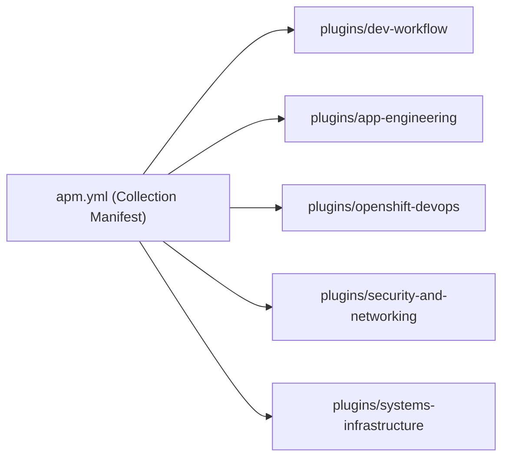

# Repository Architecture

`rl-agents-n-skills` is an [APM](https://github.com/microsoft/apm)-native multi-plugin collection organized into **five organizational domains** under `plugins/`.

## Design Principles

1. **Domain-Oriented Plugins**: Cohesive, independently installable APM plugins (`plugins/<domain>/`) aligned to engineering and operational domains.
2. **Lean Skills with Self-Contained References**: Each skill's `SKILL.md` is a concise (`<= 100`-line) router and constraint contract backed by `references/*.md` for deep guides, templates, and accumulated knowledge.
3. **Subagents as the Exception**: Subagents live in `plugins/<domain>/.apm/agents/` only when context isolation, tool sandboxing, or independent/adversarial review is required.
4. **Pure APM-Native Layout**: Primitives live strictly inside `plugins/<domain>/.apm/` (`skills/`, `agents/`) alongside `apm.yml` and `.claude-plugin/plugin.json`.

## Topology & Folder Layout



```text
rl-agents-n-skills/
├── apm.yml                        # Root collection manifest (all 5 domain plugins)
├── AGENTS.md                      # Canonical repository instructions & governance
├── CLAUDE.md                      # 3-line bridge to AGENTS.md
├── architecture.md                # This file (future-state plugin/skill/agent catalog)
├── install.md                     # APM installation & lifecycle guide
├── migration-map.md               # Legacy-to-APM transition mapping
├── docs/                          # Standards & upstream alignment notes
└── plugins/
    └── <domain>/
        ├── apm.yml                # Plugin APM manifest
        ├── README.md              # Domain plugin overview
        ├── .claude-plugin/
        │   └── plugin.json        # Claude Code plugin metadata
        └── .apm/
            ├── skills/
            │   └── <gerund-skill>/
            │       ├── SKILL.md           # <= 100-line router
            │       ├── references/        # Deep guides & acceptance-criteria.md
            │       ├── assets/            # Optional standalone templates & policy configs
            │       ├── scripts/           # Optional executable helper/validation scripts
            │       ├── tests/             # Optional pytest suites for scripts/
            │       └── evals/evals.json   # Routing verification cases
            └── agents/                    # Optional justified subagents (*.md)
```

---

## Domain Plugins, Skills, References & Subagents

### 1. `plugins/dev-workflow`
Software engineering lifecycle, GitHub workflows, spec-driven development, architecture documentation, and skill evolution.

- **Skills & References**
  - `managing-dev-sessions` — Session startup/shutdown discipline, epistemic labeling, and `AI/` audit-trail maintenance.
    - `references/ai-session-files.md` — Schemas for `WORKLOG.md`, `CHANGES.csv`, `COMMANDS.sh`, and `COMMIT_INFO.txt`.
    - `references/project-context-manifest.md` — Public-safe repo-root project manifest (`work_tracking`, Sonar, `security_issue_routing`).
    - `references/process-knowledge.md` — Accumulated workflow lessons, `Verified/Inferred/Unknown` discipline, and single-writer ownership.
  - `managing-github-workflows` — Branch-first PR lifecycle, `gh` CLI triage, Dependabot ordering, and Ruleset management.
    - `references/git-conventions.md` — Branch naming and conventional commit formatting.
    - `references/rulesets-and-ci.md` — GitHub Ruleset API, status check matching, and OCIO §2.1/OSS standards.
    - `references/sast-and-release-ci.md` — Gitleaks + SonarQube Cobertura, Release Please, and DinD + Trivy SBOM patterns.
    - `references/workflow-knowledge.md` — Accumulated CI/Ruleset lessons.
  - `driving-spec-development` — Spec-first development gates before implementation.
    - `references/spec-kit.md` — GitHub Spec-Kit (`specify-cli`) phases, extensions, and presets.
    - `references/spec-kitty.md` — Spec-Kitty work-package (`WP`) lifecycle, validation, and BC Gov §1 requirements mapping.
    - `assets/templates/{spec,plan,work-package}.md.j2` — Jinja templates for SDD specs, plans, and work packages.
  - `documenting-architecture` — Architecture/UML diagramming, CLI exports, and copy-first document versioning.
    - `references/ten-diagram-suite.md` — Canonical 10-diagram production suite.
    - `references/plantuml-templates.md` — Index of diagram template skeletons.
    - `references/doc-versioning.md` — Copy-first versioning rules and `.md`/`.pdf` parity checks.
    - `assets/templates/{sequence,class,state,c4-context}.puml`, `architecture.{mmd,drawio}` — Standalone PlantUML, Mermaid, and draw.io XML templates.
  - `evolving-agent-skills` — Pre-session knowledge recall and post-session skill promotion/auditing.
    - `references/evolution-log.md` — Cross-session evolution log.
    - `references/knowledge-and-promotion.md` — `CAUSE`/`FIX` capture rules, promotion thresholds, and health checks.
    - `assets/templates/seven-section-skill-template.md` — Standard 7-section skeleton for authoring new skills.
- **Subagents**
  - `agent-evolution.md` — Context-isolated session-end reviewer that scans `AI/` logs and updates skill knowledge.

### 2. `plugins/app-engineering`
BC Gov .NET 10 / EF Core / REST APIs, React & Design System, DIAM/OIDC IAM, observability, and local development.

- **Skills & References**
  - `building-dotnet-apis` — .NET 10 + EF Core Pomelo MariaDB data-access, service layer, and BC Gov REST API compliance.
    - `references/ef-core-pomelo-patterns.md` — DbContext setup, Polly v8 resilience, `Asp.Versioning`, middleware order, RFC 9457 errors, InMemory testing.
    - `references/ef-core-migrations.md` — Canonical `dotnet ef` migration commands and naming rules.
    - `references/bc-gov-rest-api-standard.md` — Normative BC Gov REST API Development Standard mandates.
    - `references/dotnet-ci-automation.md` — .NET CI patterns: `dotnet format`, vuln checks, EF script, Coverlet/Cobertura gates.
    - `references/ef-knowledge.md` — Accumulated EF Core / MariaDB lessons.
  - `building-bc-gov-web-apps` — React/Vite web apps layering DIAM/Keycloak OIDC PKCE & .NET JWT on top of [`richfrem/bc-gov-design-system`](https://github.com/richfrem/bc-gov-design-system).
    - `references/bc-gov-design-system.md` — Thin integration layer consuming `richfrem/bc-gov-design-system` (`react` mode) with Vite + OIDC.
    - `references/design-tokens.md` — Pointer delegating v5 design tokens to `richfrem/bc-gov-design-system`.
    - `references/keycloak-realms-and-clients.md` — Pathfinder CSS realm selection, public/confidential client setup, and Gold/GoldDR DR.
    - `references/react-oidc-client-ts.md` — `oidc-client-ts` config, callbacks, and Axios interceptors.
    - `references/dotnet-jwt-and-backchannel-logout.md` — `.NET` `AddJwtBearer`, claims, and backchannel logout.
    - `references/bc-gov-reusable-services.md` — CDOGs, CHES, COMS, SonarCloud, and `bcgov-docker-local` prebuilt images.
    - `references/ux-and-accessibility-patterns.md` — WCAG 2.2 AA deltas, sensitive-field masking, consequential decision UX, and finding schema.
    - `references/dotnet-engineering-standards.md` — Indigenous UTF-8/ICU readiness, Polly v8, lockfiles, Data Protection, and concurrency invariants.
    - `references/iam-knowledge.md` — Accumulated IAM facts and pitfalls.
  - `instrumenting-observability` — Structured logging, health checks, Prometheus metrics, OpenTelemetry tracing, diagnostics, and PII log audits.
    - `references/serilog-and-health-checks.md` — Serilog `CompactJsonFormatter` and `/api/health` endpoints.
    - `references/application-diagnostics-and-errors.md` — RFC 9457 `ProblemDetails`, W3C `traceId` support ref, UI error surface matrix, and safe stand-ins.
    - `references/prometheus-and-opentelemetry.md` — `prometheus-net` metrics, Pod annotations, OTel exporters, alerts.
    - `references/sysdig-and-loki-monitoring.md` — `SysdigTeam`, `ServiceMonitor`, AlertManager/MS Teams, and Loki log routing.
    - `references/pii-in-logs-audit.md` — Multi-language PII-free logging rules and `grep` audit commands.
    - `references/observability-knowledge.md` — Accumulated observability facts and pitfalls.
    - `assets/templates/{sysdigteam,servicemonitor}.tpl.yaml` — SysdigTeam and Prometheus `ServiceMonitor` manifest templates.
  - `managing-local-dev` — Multi-project `dev-ctl`, Podman Compose, MariaDB setup, and local test execution.
    - `references/dev-ctl-guide.md` — `dev-ctl` discovery, lifecycle, and `.dev-env` onboarding.
    - `references/podman-and-mariadb-setup.md` — `podman-compose` and Homebrew MariaDB setup.
    - `references/troubleshooting-and-knowledge.md` — Common local-dev symptoms and fixes.
- **Subagents**: None (all workflows execute in the main thread).

### 3. `plugins/openshift-devops`
BC Gov Emerald OpenShift deployment, Option 2 CI/CD, platform migration & resilience analysis, and CI/CD governance.

- **Skills & References**
  - `deploying-bc-gov-workloads` — Containerfiles, Option 2 GitHub Actions, `ag-helm`, 4-tool policy gate, and Emerald mechanics.
    - `references/containerfile-standards.md` — .NET 10 and Node 22/React non-root port-8080 Containerfiles.
    - `references/github-actions-option2.md` — 5-workflow pattern, Artifactory, Trivy, `yq` GitOps, and branch protection.
    - `references/artifactory-argocd-gitops.md` — Two-repo GitOps, umbrella charts, release-tag vs. retag promotion, Apicurio, ArgoCD gating.
    - `references/emerald-platform-mechanics.md` — AVI InfraSettings, `DataClass`, `PriorityClass`, `StorageClass`, split-DNS.
    - `references/ag-helm-and-policy-gate.md` — `ag-helm-templates`, Datree/Polaris/kube-linter/Conftest gate, ArgoCD CRDs.
    - `references/ag-helm-api-and-shapes.md` — `$p` dict API, fragment output shapes, and router-ingress selector.
    - `references/policy-remediation-matrix.md` — Four-tool policy failure-to-fix table and cross-tool nuances.
    - `references/networkpolicy-patterns.md` — `ag-template.networkpolicy` intent API (`AllowIngressFrom.namespaces`) and raw NP patterns.
    - `assets/policies/` — Datree, Polaris, kube-linter, and Conftest Rego policy-as-code configs.
    - `assets/templates/` — Non-root port-8080 Containerfiles plus Helm (`ag-template.*`), ArgoCD (`gitopsteam.tpl.yaml`, `helm-oci-application.tpl.yaml`, `imageupdater.tpl.yaml`, `route-patcher-job.tpl.yaml`), `allow-user-workload-monitoring.yaml`, `go-crond-deployment.tpl.yaml`, retag-promotion, and CI/repo bootstrap templates.
    - `scripts/init.py`, `scripts/scaffold.py`, `scripts/validate.py`, `scripts/check_platform_rules.py` (+ `tests/`) — Full-repo Emerald bootstrapper, unified Helm/NP/CI generator, 4-tool policy runner, and BC Gov platform-rules checker.
  - `analyzing-ocp-platforms` — Single-app migration readiness, resilience posture (`R01`–`R15`), and multi-app program assessments.
    - `references/oc-collection-and-toolkits.md` — Phase 1 `oc` collection and analysis toolkit usage.
    - `references/migration-gaps-g1-g12.md` — Migration gap criteria (`G1`–`G12`) and remediation tasks.
    - `references/resilience-checks-r01-r15.md` — Resilience checks (`R01`–`R15`), `A`–`F` grading, and PDB/QoS patterns.
    - `references/multi-app-orchestration.md` — Private repo setup, coupling matrix, cross-cutting reports, RAG summary.
    - `references/report-format-and-pdf.md` — Report outlines, versioning headers, and Pandoc/Chrome PDF rendering.
    - `references/standards-catalog.md` — Unified `PS-*`, `AD-*`, `ISB-*`, `OCP-*`, `K8S-*`, `SEC-*` standards catalog.
  - `auditing-cicd-governance` — Platform-agnostic (SaaS, container, hybrid) deployment and CI/CD control assessments.
    - `references/control-matrix-and-deliverables.md` — `CM-01`..`CM-05` control matrix, roadmaps, and executive packaging.
- **Subagents**
  - `ocp-migration-analyst.md` — Context-isolated worker for parsing raw `oc get -o yaml` migration dumps.
  - `ocp-resilience-analyst.md` — Context-isolated worker for parsing raw workload, PDB, and pod YAML dumps.

### 4. `plugins/security-and-networking`
Application security, Vault secrets, database security, data lineage/STRA/PIA, Zero Trust, and enterprise/OpenShift networking.

- **Skills & References**
  - `securing-bc-gov-workloads` — OWASP Top 10, DevSecOps CI gates, Vault/ESO secrets, DB security controls, RBAC & image provenance.
    - `references/owasp-dotnet-react-oidc.md` — OWASP mapping, ASP.NET/SPA blind spots, `AuditInterceptor`, real-wiring test assurance, SAST/DAST gates.
    - `references/llm-and-markdown-security.md` — Prompt injection, pre-retrieval authz, tool bounds, and Markdown/frontmatter XSS/SSRF checks.
    - `references/vault-secrets.md` — Vault KV v2 paths, `vault-action@v3`, ESO CRDs, and Pod Injector annotations.
    - `references/database-security-standard.md` — 23 mandatory BC Gov Database Security Standard controls.
    - `references/ocp-rbac-and-image-audit.md` — `oc`/`jq` RBAC least-privilege, image provenance, and STRA/PIA checks.
    - `assets/templates/{secretstore,externalsecret}.yaml`, `assets/templates/{vault-agent-injector,azure-keyvault-secretstore}.tpl.yaml` — ESO Vault, Vault Agent Injector, and Azure Key Vault SecretStore templates.
  - `mapping-data-lineage` — ISCF classification, cross-boundary data flow ledgers, FOIPPA s.30.1 residency, and PIA triggers.
    - `references/iscf-and-risk-matrix.md` — ISCF data classification and cross-boundary risk matrix.
    - `references/foippa-residency-and-pia.md` — External AI/OCR residency rules, MISA DPA, and PIA trigger checklist.
    - `references/oc-discovery-commands.md` — `oc`/`jq` discovery for ConfigMaps, env URLs, and Redis streams.
  - `designing-enterprise-networks` — Zero Trust/SASE architecture, CCNP routing/switching/WAN, L2/L3 security controls, and IMIT mapping.
    - `references/zero-trust-sase.md` — NIST SP 800-207, SASE components, CISA ZTMM, and vendor evaluation scorecard.
    - `references/routing-switching-wan.md` — VLSM, OSPF/BGP/EIGRP, STP/EtherChannel, MPLS/DMVPN/SD-WAN, QoS, FHRP.
    - `references/ios-security-controls.md` — ACLs, NAT/PAT, IKEv2 IPsec, Zone-Based Firewall, and L2 hardening.
    - `references/bc-gov-imit-network-mapping.md` — BC Gov IMIT 6.28 / 6.13 / 5.08 network control mapping.
  - `designing-bc-gov-networks` — 6-step BC Gov OCP connectivity reasoning, SDN zone classification, and NetworkPolicy authoring.
    - `references/sdn-zones-and-imit-standards.md` — ISCF→SDN→IMIT 6.13 mapping, guardrails, Forward Proxy, Public VIPs, 3PG.
    - `references/hosting-tiers-and-porter-tcp.md` — Platform hosting tiers (Silver/Gold/GoldDR/Emerald) and Porter TCP ingress/egress connectivity.
    - `references/networkpolicy-patterns.md` — Two-policy rule, DNS egress, `ag-helm` intent API, Conftest rules, `oc` debug.
    - `assets/templates/{allow-egress-dns,allow-frontend-to-api,allow-ingress-from-router,allow-egress-external-cidr,allow-cross-namespace}.yaml` — Standalone NetworkPolicy YAML templates.
  - `auditing-ocp-network-posture` — 4-phase live OCP container network posture audit and PDF report pipeline.
    - `references/collection-commands.md` — Phase 1 `oc`/`jq` collection for NPs, Services, Routes, and egress URLs.
    - `references/gap-analysis-rubrics.md` — Cross-NS NP risk matrix, stale NP (`>365d`) detection, Route TLS/Admin UI checks.
    - `references/report-and-pdf-rendering.md` — 6-section report spec, `NET-NN` effort scale, and Pandoc/Chrome PDF render.
- **Subagents**
  - `security-architect.md` — Independent/adversarial read-only security & STRA/PIA reviewer (`Read, Grep, Glob` only).
  - `container-network-analyst.md` — Context-isolated worker for multi-namespace NetworkPolicy, Service, and Route YAML dumps.

### 5. `plugins/systems-infrastructure`
Unix/Linux/Solaris administration, DNS diagnostics, and Cisco IOS/NX-OS networking.

- **Skills & References**
  - `administering-unix-systems` — RHEL 7/8/9 and Solaris 9/10/11 SPARC administration, triage, and DNS diagnostics.
    - `references/linux-rhel.md` — `systemd`, LVM, SELinux, `nmcli`, `firewalld`, `dnf`, `perf`/`kdump`, hardening, logs.
    - `references/solaris-sparc.md` — SMF, ZFS, Zones, IPMP, DTrace, SPARC HW diagnostics, OBP, LDoms, VxVM/VxFS.
    - `references/dns-diagnostics.md` — `dig`, `nslookup`, `host`, SPF/DKIM/DMARC, DNSSEC, AXFR, and troubleshooting.
  - `configuring-cisco-networks` — Cisco IOS, IOS-XE, and NX-OS switching, routing, security, recovery, and lab configuration.
    - `references/ios-routing-switching.md` — Interfaces, VLANs/trunks, STP, EtherChannel, OSPF, HSRP, NAT/PAT, ACLs, DHCP.
    - `references/nxos-and-recovery.md` — ROMmon/Catalyst password recovery, IOS image upgrades, NX-OS vPC/VDC, lab tips.
- **Subagents**: None (all workflows execute in the main thread).
