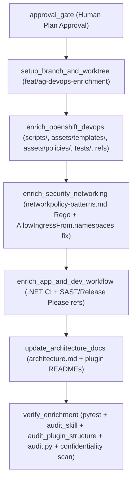

# `ag-devops` Enrichment Plan (`rl-agents-n-skills`)

## Objective

Enrich `rl-agents-n-skills` with the highest-value **executable Python scripts**, **Helm/CI templates**, **policy-as-code assets**, **CI/CD references**, and **pytest suites** from `<local-ag-devops-repo>`, sanitized per `AGENTS.md` confidentiality rules and packaged cleanly without symlinks on a new feature branch (`feat/ag-devops-enrichment`).

## Subagent Gate Decision (`ag-devops/plugins/ag-devops/agents/`)

| Legacy `ag-devops` Agent | Decision | Rationale (`authoring-subagents` 3-reason gate) |
|---|---|---|
| `init-emerald.md` | **Retire → Skill** | Interactive 8-question wizard; belongs in main-thread skill. |
| `scaffold-emerald-app.md` | **Retire → Skill** | Interactive 6-question topology wizard; belongs in main-thread skill. |
| `manifest-validator.md` | **Retire → Skill + `validate.py`** | Procedural checklist duplicating `deploying-bc-gov-workloads` + `scripts/validate.py`. |

No new subagents are added; all 3 fail the isolation/sandboxing/adversarial gate.

## Execution Graph (DAG)

## Detailed Scope

1. **`plugins/openshift-devops/.apm/skills/deploying-bc-gov-workloads/`**
   - **`scripts/`**: Sanitized `scaffold.py` (default `--avi-class dataclass-medium`, no `ag-devops` branding) and `validate.py` (multi-`--values` support, clean `run()` signature).
   - **`assets/policies/`**: `datree-policies.yaml`, `polaris.yaml` (scrubbed `test-app-postgresql`), `kube-linter.yaml`, `avi-infrasetting-annotation.rego`, `network-policies.rego`, `routes-edge-termination.rego`.
   - **`assets/templates/`**: Physical copies (no symlinks) of the 16 Helm/CI templates (`Chart.tpl.yaml`, `values.tpl.yaml` with `dataclass-medium`, `values-env.tpl.yaml`, `deployment.tpl.yaml`, `service.tpl.yaml`, `route.tpl.yaml`, `ingress.tpl.yaml`, `statefulset.tpl.yaml`, `hpa.tpl.yaml`, `pdb.tpl.yaml`, `pvc.tpl.yaml`, `job.tpl.yaml`, `cronjob.tpl.yaml`, `configmap.tpl.yaml`, `serviceaccount.tpl.yaml`, `networkpolicy.tpl.yaml`, `cd.tpl.yml`, `docker.tpl.yml`, `sast.tpl.yml`, `Makefile.tpl`).
   - **`tests/`**: Sanitized `test_scaffold.py` and `test_validate.py` covering `@@MARKER@@` checks, path-traversal guard, `--dry-run`/`--force`, and graceful missing-CLI handling.
   - **`references/`**: Add `ag-helm-api-and-shapes.md` (from `SIMPLE-API.md` + `CD.md` fragment shapes + `EXAMPLES.md` router selector) and `policy-remediation-matrix.md`; fix `networkpolicy-patterns.md` (`allow-egress-https`/`allow-dns` missing `to:`, `AllowIngressFrom.namespaces`).
2. **`plugins/security-and-networking/.apm/skills/designing-bc-gov-networks/`**
   - Update `references/networkpolicy-patterns.md` with `AllowIngressFrom.namespaces`, `openshift-ingress` router selector, and `network-policies.rego` cross-namespace `namespaceSelector` rule.
3. **`plugins/app-engineering/.apm/skills/building-dotnet-apis/`**
   - Add `references/dotnet-ci-automation.md` (`dotnet format --verify-no-changes`, `dotnet list package --vulnerable`, `dotnet-ef migrations script -i`, Coverlet + Cobertura threshold gating).
4. **`plugins/dev-workflow/.apm/skills/managing-github-workflows/`**
   - Add `references/sast-and-release-ci.md` (Gitleaks + SonarQube Cobertura pattern with `<sonarqube-host>` placeholder, Release Please, DinD + Buildx + Trivy SBOM summary).
5. **Confidentiality Scrub**: Strip `e7c7c2`, `bcgov-c`, `stanley-*`, `142.34.208.0/24` (use `198.51.100.0/24`), `Attorney General`, `ag-devops`, and personal emails.
