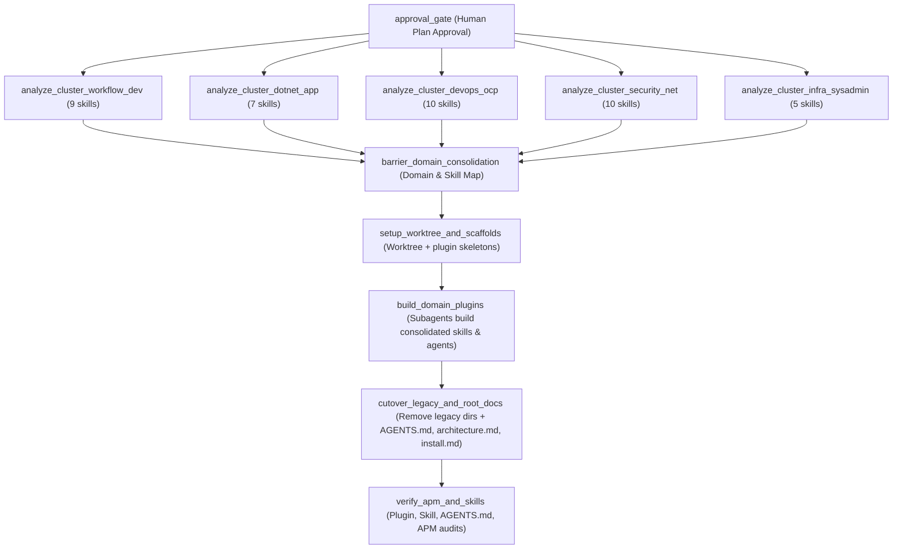

# APM Domain Refactor & Consolidation Plan (`rl-agents-n-skills`)

## Objective

Reorganize `rl-agents-n-skills` (currently 41 root skill directories + 24 root `agents/*.md` files) into a clean, APM-native multi-plugin repository under `plugins/<domain>/.apm/`, consolidating overlapping skills into fewer, logical gerund-named skills with rich `references/` directories, and producing root `AGENTS.md`, `CLAUDE.md` (<=5-line bridge), `architecture.md`, `install.md`, and `apm.yml`.

## Execution Strategy: Graph (DAG)

## Phase Breakdown

### Phase 1: Parallel Read-Only Domain & Skill Analysis (5 Research Subagents)
Each subagent reads its assigned `SKILL.md` files, sub-files, and corresponding `agents/*.md` files to catalog:
- Core capabilities, commands, scripts, and `<SKILL>_KNOWLEDGE` entries (preserving confidentiality rules).
- Overlap/duplication candidates where multiple small/related skills should merge into one cohesive skill with `references/`.
- Whether any `agents/*.md` truly requires subagent isolation (context isolation, tool sandboxing, or adversarial review) vs. being absorbed into a skill.

### Phase 2: Sync Barrier — Domain Taxonomy & Consolidation Design
Synthesize all 5 reports into:
1. **Organizational Domains** (`plugins/<domain>/`), e.g.:
   - `dev-workflow` (session/git/github/docs/diagrams/spec-driven dev/agent evolution)
   - `app-engineering` (.NET/EF Core/local-dev/REST API/BC Gov Design System/IAM/observability/data-flow)
   - `openshift-devops` (CI/CD, Emerald OCP, Containerfiles, resilience, migration, multi-app)
   - `security-and-networking` (AppSec/STRA, Vault, DB security, Zero Trust, network architecture, SDN/NetworkPolicy)
   - `systems-infrastructure` (Sysadmin, RHEL, Solaris, DNS, Cisco IOS)
   *(Exact domain boundaries will be finalized from Phase 1 evidence.)*
2. **Consolidated Skill Map**: Fewer, gerund-named skills (`<= 100` lines in `SKILL.md`, detailed guides/knowledge moved to `references/`).

### Phase 3: Isolated Worktree Build & Cutover
1. Create an isolated git worktree/branch (`.worktrees/apm-domain-refactor`).
2. Scaffold each domain plugin with `authoring-plugins` (`apm.yml`, `.claude-plugin/plugin.json`, `.apm/skills/`, `.apm/agents/`, `README.md`).
3. Dispatch domain-builder subagents to author the consolidated skills and retained subagents, preserving all generic knowledge and confidentiality rules.
4. Remove legacy root skill directories and root `agents/`, write root `apm.yml` collection manifest, `AGENTS.md`, `CLAUDE.md` (<=5-line bridge), `architecture.md`, `install.md` (modeled on `agent-plugins-skills/install.md`), and update `README.md`.

### Phase 4: Verification Gate
- `authoring-plugins`: `audit_plugin_structure.py` and `audit.py` on every `plugins/<domain>/`
- `authoring-skills`: `audit_skill.py --mode source` on every consolidated skill
- `authoring-instructions`: `audit_agents_md.py AGENTS.md --strict` and `CLAUDE.md` bridge check
- `packaging-with-apm`: `validate_apm_package.py` on every plugin and root `apm.yml`
