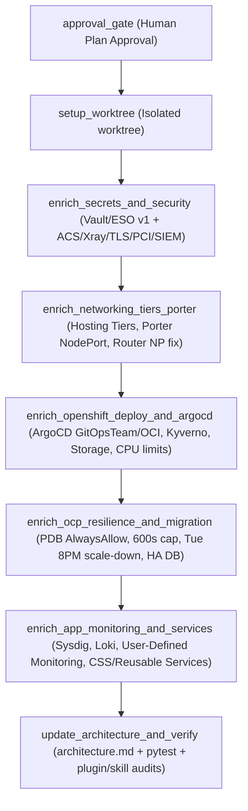

# `platform-developer-docs` Enrichment Plan (`rl-agents-n-skills`)

## Objective

Mine `temp/repos/platform-developer-docs` (official BC Gov Private Cloud PaaS technical documentation) to fix factual mismatches and enrich skills, references, and `assets/templates/` across `openshift-devops`, `security-and-networking`, and `app-engineering` on a feature branch (`feat/platform-docs-enrichment` or stacked on `feat/ag-devops-enrichment`).

## Execution Graph (DAG)

## Key Fixes & Additions

1. **`security-and-networking` / `securing-bc-gov-workloads`**
   - Fix Vault Enterprise `platform-services` namespace, `<license-plate>-nonprod`/`prod` KV v2 engines (no hyphens in keys), `auth/k8s-{silver,gold,golddr,emerald}`, `<license-plate>-vault` KSA, `external-secrets.io/v1`, Vault Agent Injector vs. ESO (1-month OIDC token vs. Azure Key Vault).
   - Add `assets/templates/vault-agent-injector.tpl.yaml` & `azure-keyvault-secretstore.tpl.yaml`; fix `secretstore.yaml` & `externalsecret.yaml`.
   - Add Dedicated Prod TLS cert, non-PCI-DSS warning, Red Hat ACS (`acs.developer.gov.bc.ca`), JFrog Xray, SIEM retention (2m/13m), `bcgov/owasp-zap-openshift`, IDIR vs `@github` RBAC audit, and `bcgov/backup-container` / `pgbackrest`.
2. **`security-and-networking` / `designing-bc-gov-networks`**
   - Add Hosting Tiers (`Silver`, `Gold/GoldDR`, `Emerald`), `OpenShift SDN` vs `NSX-T`, and **Porter Operator `TransportServerClaim`** (Feb 2026 `NodePort` OVN-Kubernetes requirement).
   - Fix `assets/templates/allow-ingress-from-router.yaml` `podSelector` and reconcile DNS `53`/`5353`.
3. **`openshift-devops` / `deploying-bc-gov-workloads`**
   - Fix Argo CD `Application` CRD in `ag-helm-and-policy-gate.md`, `spec.gitOpsMembers` / `nonprod` / `@github` rules in `artifactory-argocd-gitops.md`, shared Argo CD URLs, 3-min poll (no Emerald webhooks), `helm-oci-virtual`, and `argocd-helm-local` visibility caveat.
   - Add `assets/templates/gitopsteam.tpl.yaml`, `helm-oci-application.tpl.yaml`, and `allow-user-workload-monitoring.yaml`.
   - Update `emerald-platform-mechanics.md`: `oc login --web`, **Kyverno** (`DataClass: Invalid`, CronJob `5m`/`1h` PVC, `spec.timeZone`, `go-crond`), `netapp-file-backup`, `>100Gi` OCIO S3 Object Storage, `platform-services-controlled-default`, Product Registry (`registry.developer.gov.bc.ca`), and CPU limits guidance (`limits.cpu` CFS throttling vs `ag-devops` policy exception).
4. **`openshift-devops` / `analyzing-ocp-platforms`**
   - Add PDB `unhealthyPodEvictionPolicy: AlwaysAllow` & `maxUnavailable: 0` override, `terminationGracePeriodSeconds > 600` cap, Tuesday 8 PM automated scale-down (`Progressing > 1 yr` / `> 100` restarts), 3-pod HA DB + `>= 20%` PVC headroom (Patroni 90% halt) + `PostgresCluster` CR, and CronJob/Jenkins migration gaps.
5. **`app-engineering` / `instrumenting-observability` & `building-bc-gov-web-apps`**
   - Add **Sysdig Monitor** (`SysdigTeam` CR in `*-tools`), **OCP User-Defined Monitoring** (`ServiceMonitor`, `PrometheusRule`, `openshift-user-workload-monitoring` NP), **Loki** (14d retention, plaintext, `X-Forwarded-For`), **Uptime.com**, **Pathfinder CSS** (`bcgov.github.io/sso-requests/`), and **BC Gov Reusable Services** (CHES, CDOGS, COMS, GETOK, WeasyPrint, Geocoder, Fathom/Matomo).
