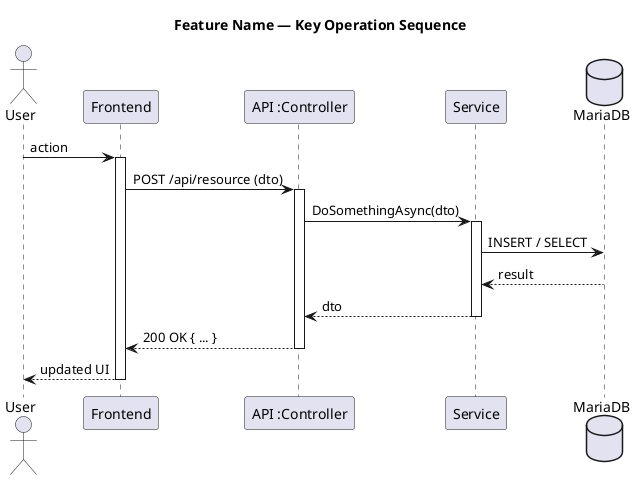
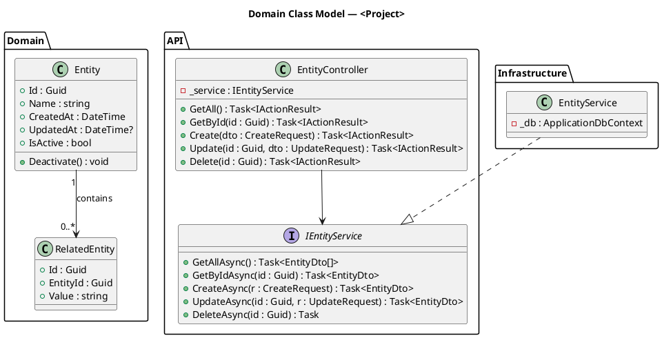
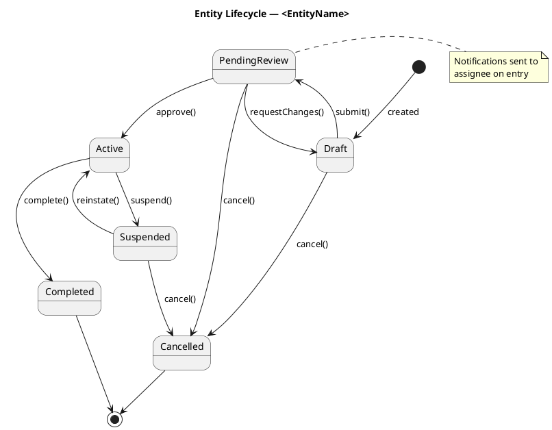
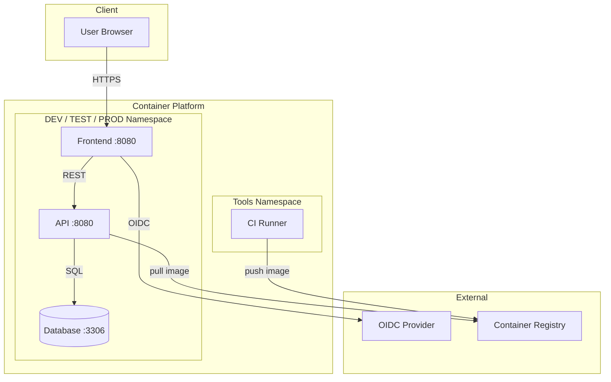

# PlantUML & Mermaid Skeleton Templates

Reference templates for standard PlantUML and Mermaid diagram types. Copy the
appropriate skeleton, rename, and fill in project specifics.

## Contents

- [Sequence diagram](#sequence-diagram) • [Class diagram](#class-diagram) • [State diagram](#state-diagram) • [C4 Context](#c4-context) • [Mermaid architecture quickview](#mermaid-architecture-quickview)

## Sequence diagram



## Class diagram



## State diagram



## C4 Context

```plantuml
@startuml
!include https://raw.githubusercontent.com/plantuml-stdlib/C4-PlantUML/master/C4_Context.puml
LAYOUT_WITH_LEGEND()
title System Context — <Project>

Person(user, "End User", "Uses the system via browser")
Person(admin, "Administrator", "Manages configuration")

System_Boundary(sys, "<Project>") {
    System(frontend, "React SPA", "Single page application")
    System(api, "REST API", "Backend service")
    System(db, "Database", "Relational data store")
}

System_Ext(idp, "OIDC Identity Provider", "Authentication (OIDC / PKCE)")
System_Ext(platform, "Container Platform", "Managed Kubernetes / OpenShift")

Rel(user, frontend, "Uses", "HTTPS 443")
Rel(admin, frontend, "Manages", "HTTPS 443")
Rel(frontend, api, "API calls", "HTTPS 443")
Rel(api, db, "Reads/writes", "TCP 3306")
Rel(frontend, idp, "Auth", "OIDC / PKCE")
Rel(api, idp, "Token validation", "JWKS")

@enduml
```

## Mermaid architecture quickview


