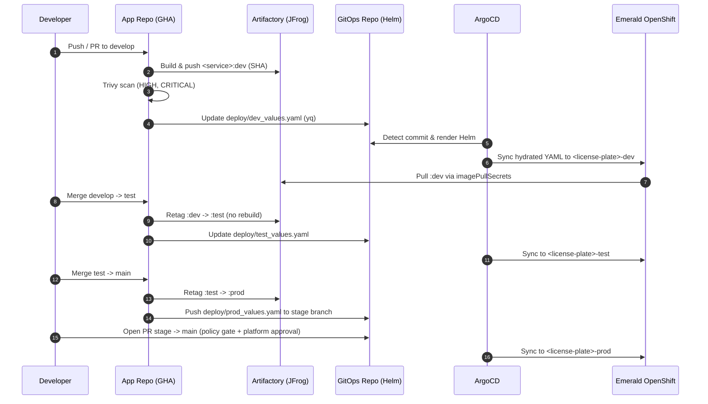

# Artifactory (JFrog), ArgoCD & Two-Repo GitOps on Emerald

End-to-end guide for the BC Gov Emerald **Option 2** pipeline: GitHub Actions (CI) → JFrog Artifactory (`artifacts.developer.gov.bc.ca`) → GitOps Helm Repo (`tenant-gitops-<license-plate>`) → ArgoCD → Emerald OpenShift.

## Contents

- [Infrastructure Onboarding](#infrastructure-onboarding)
- [Two-Repo GitOps & Umbrella Helm Layout](#two-repo-gitops--umbrella-helm-layout)
- [Promotion Models (Release-Tag vs. Retag)](#promotion-models-release-tag-vs-retag)
- [JFrog Artifactory, Pull Secrets & Apicurio](#jfrog-artifactory-pull-secrets--apicurio)
- [ArgoCD Reconciliation & App-of-Apps](#argocd-reconciliation--app-of-apps)
- [Argo CD Image Updater](#argo-cd-image-updater)
- [Argo CD Notifications & Route TLS Patching](#argo-cd-notifications--route-tls-patching)
- [Production Gating (`develop`/`stage` → `main`)](#production-gating-developstage--main)
- [Pipeline Reality-Check Pitfalls](#pipeline-reality-check-pitfalls)

---

## Infrastructure Onboarding

Before writing CI/CD workflows, provision the four platform prerequisites in `<license-plate>-tools`:

1. **Namespace & Repo Access**: Request OpenShift namespace access and creation of **both** the Application repo (full team access) and GitOps repo (`bcgov-c/tenant-gitops-<license-plate>`) via platform onboarding.
2. **Keycloak UI First-Login Prerequisite**: Every user listed in `spec.projectMembers` must attempt to log in to the cluster's shared Argo CD UI **once** before their Keycloak ID exists in the realm for role assignment:
   - `https://gitops-shared.apps.silver.devops.gov.bc.ca`
   - `https://gitops-shared.apps.gold.devops.gov.bc.ca`
   - `https://gitops-shared.apps.golddr.devops.gov.bc.ca`
   - `https://gitops-shared.apps.emerald.devops.gov.bc.ca`
3. **GitOpsTeam CR (`<license-plate>-tools`)**: Provision [gitopsteam.tpl.yaml](../assets/templates/gitopsteam.tpl.yaml) in `<license-plate>-tools`:
   - `spec.gitOpsMembers` (exact camelCase) controls `tenant-gitops-<license-plate>` GitHub access: `admins`, `writers`, `maintainers`, `readers`, `triage`, plus GitHub team lists (`adminTeams`, `writerTeams`, `maintainerTeams`, `readerTeams`, `triageTeams`). Use **plain GitHub IDs only** (no `@github` suffix, no IDIRs).
   - `spec.projectMembers` controls Argo CD UI access via Keycloak: `maintainers` (all namespaces including `prod`), `nonprod` (`dev`, `test`, `tools` only; cannot overwrite `GitOpsTeam`/`GitOpsAlliance` in `tools`), and `readers` (read-only across `prod` and `nonprod`). Use **`<github-id>@github`** (case-insensitive) or **IDIR UPN** (`first.last@gov.bc.ca`); individual IDs only (no GitHub teams).
4. **ArtifactoryProject & Service Account (`<license-plate>-tools`)**: Create an `ArtifactoryProject` CR in `<license-plate>-tools` and wait for BCDevExchange approval. Once created, OpenShift auto-creates an `ArtifactoryServiceAccount` (`default`), which an admin must **manually add as a Project Member (`Developer, Contributor`) in the JFrog Artifactory UI** before it can push/pull.
5. **Pull Secrets (`<env>` namespaces)**: Create and link the Artifactory `imagePullSecret` in **every** namespace (`dev`, `test`, `prod`) that pulls images, and ensure its registry server URL is **`artifacts.developer.gov.bc.ca`** (not legacy `artifacts.docker.gov.bc.ca`).

---

## Two-Repo GitOps & Umbrella Helm Layout

Separate **application source** from **deployment state**:

1. **Application Repo (`<org>/<app-repo>`)**: Source code, `Containerfile`, unit/integration tests, OpenAPI specs, and GitHub Actions CI workflows.
2. **GitOps Infrastructure Repo (`<org>/tenant-gitops-<license-plate>`)**:

```text
tenant-gitops-<license-plate>/
├── .github/
│   ├── workflows/
│   │   └── policy-enforcement.yaml   # Datree / Polaris / kube-linter / Conftest gate
│   └── policies.yaml
├── applications/
│   └── argocd/
│       ├── <license-plate>-gitops-dev.yaml
│       ├── <license-plate>-gitops-test.yaml
│       └── <license-plate>-gitops-prod.yaml
├── charts/
│   ├── <service-a>/                  # Per-service Helm chart (Chart.yaml, values.yaml, templates/)
│   ├── <service-b>/
│   └── <app>-gitops/                 # Umbrella chart (charts/ sub-deps + shared NetworkPolicies)
└── deploy/
    ├── dev_values.yaml
    ├── test_values.yaml
    └── prod_values.yaml
```

- **Umbrella vs. Per-Service Charts**: Per-service charts define workload resources (`Deployment`, `Service`, `Route`). The umbrella chart (`charts/<app>-gitops/`) declares subchart dependencies, runs `helm dependency build` / `update` in CI, and holds cross-service `NetworkPolicy` and secret-reference templates.

### Branch-to-Namespace Mapping

| App Repo Branch / Tag | GitOps Repo Target Branch | ArgoCD Target Namespace |
|---|---|---|
| `develop` | `develop` | `<license-plate>-dev` |
| `test` | `test` | `<license-plate>-test` |
| `main` / `v<semver>` tag | `develop` or `stage` → PR → `main` | `<license-plate>-prod` |

---

## Promotion Models (Release-Tag vs. Retag)

Two Option 2 promotion patterns are used on Emerald; pick one per project:

### Model A: Release-Tag Build (`v1.0.0`) + `appVersion` Bump

1. **Dev**: PR merges to `develop` → CI builds/pushes `:dev` (or `:latest`), updates `deploy/dev_values.yaml` on GitOps `develop` → ArgoCD syncs `<license-plate>-dev`.
2. **Prod**: PR `test` → `main` merges → developer creates a **release tag** (`v1.0.0`) on `main` → tag pipeline builds/pushes `1.0.0`, updates `deploy/prod_values.yaml`, bumps **`appVersion`** in `Chart.yaml`, and runs `helm dependency build` → pushes to GitOps `develop`/`stage` for PR review into `main`.

### Model B: Build-Once, Retag-to-Promote (`:dev` → `:test` → `:prod`)



Use [promote-retag.tpl.yml](../assets/templates/promote-retag.tpl.yml) to pull, retag, push, and update `deploy/<env>_values.yaml` with `yq` without rebuilding the binary.

---

## JFrog Artifactory, Pull Secrets & Apicurio

- **Registry URL**: `https://artifacts.developer.gov.bc.ca`
- **Air-gapped base images**: Emerald blocks direct internet egress; mirror or proxy third-party base images and packages through Artifactory.
- **Cluster-wide prebuilt & cached images (`artifactory-creds`)**: Every project set includes a cluster-wide `artifactory-creds` pull secret for remote (caching) Docker repos and Platform Services prebuilt images in `bcgov-docker-local` (e.g., `backup-container-*`, `caddy-s2i-builder`, `patroni-postgres`, `mongodb-36-ha`, `codeql`, `app-assessment`). Reference `imagePullSecrets: [{ name: artifactory-creds }]` on Deployments/StatefulSets; when pointing an `ImageStream` at Artifactory, set `ReferencePolicy: source` (never `local`).
- **Archeobot CRs (`ArtifactoryProject` & `ArtifactoryServiceAccount`)**:
  ```bash
  oc process -f https://raw.githubusercontent.com/bcgov/platform-services-archeobot/master/archeobot/config/samples/tmpl-artifactoryproject.yaml -p NAME="<ap-name>" | oc create -f -
  oc process -f https://raw.githubusercontent.com/bcgov/platform-services-archeobot/master/archeobot/config/samples/tmpl-artifactoryserviceaccount.yaml -p NAME="<sa-name>" -p DESCRIPTOR="<description>" | oc create -f -
  ```
  - Someone with OpenShift namespace admin must log in to `https://artifacts.developer.gov.bc.ca` **at least once** before creating `ArtifactoryProject`, or the project will be created with no admins.
  - **Quota & `approval_status`**: Default quota is **5 GB**. Request increases via `oc patch artproj <ap-name> -p '{"spec":{"quota_in_Gi":"10"}}' --type merge`. Track `approval_status` (`pending` → `approved` → `nothing-to-approve`) with `oc describe artproj <ap-name>`. If a request is **rejected** and the rejection stands, you **must** delete the `ArtifactoryProject` (for new projects) or revert `spec.quota_in_Gi` to the current quota so `approval_status` resets to `nothing-to-approve` — otherwise Archeobot ignores all subsequent requests.
  - **Gold → Gold DR federation caveat**: Archeobot runs **only on Gold**, not Gold DR. Create `ArtifactoryServiceAccount` CRs on Gold and **manually sync** the generated pull secrets to Gold DR. Likewise, project members and local repos (auto-converted to Federated within ~10 min) sync Gold → Gold DR only — never create repos or modify project members directly in Gold DR.
- **CI Auth**: Use `docker/login-action` (`ARTIFACTORY_URL`, `ARTIFACTORY_SERVICE_ACCOUNT`, `ARTIFACTORY_SERVICE_ACCOUNT_TOKEN`) or `jfrog/setup-jfrog-cli`.
- **Apicurio Service Registry**: For API builds, validate OpenAPI specs, convert `YAML` → `JSON`, and publish to the dev/prod Service Registry using a DIAM-issued `clientId` and secret (`sr-developer` role).

---

## ArgoCD Reconciliation & App-of-Apps

1. Create one ArgoCD `Application` manifest per environment under `applications/argocd/` using [argocd-application.tpl.yaml](../assets/templates/argocd-application.tpl.yaml) (placed in `<license-plate>-tools` or any namespace in your project set via **Apps in Any Namespace**, with `spec.project: <license-plate>`).
2. Point `source.path` at the umbrella chart (`charts/<app>-gitops`) and `helm.valueFiles` at `../../deploy/<env>_values.yaml`.
3. **Docker Helm OCI charts (`helm-oci-virtual`)**: Shared Argo CD projects restrict allowed `repoURL`s. To consume upstream Docker Helm OCI charts with your own GitOps values file, use a **multi-source `Application`** manifest ([helm-oci-application.tpl.yaml](../assets/templates/helm-oci-application.tpl.yaml)) pointing to `artifacts.developer.gov.bc.ca/helm-oci-virtual` and referencing `$values/...` from `tenant-gitops-<license-plate>` (multi-source creation is not supported in the Argo CD UI).
4. **Local Artifactory Helm repo (`argocd-helm-local`) caveat**: Argo CD uses a single shared credential set to read local Artifactory Helm repositories. Any other Argo CD project on the same cluster that knows your repo name, chart name, and version can theoretically see/use that chart. Store truly private Helm charts directly in `tenant-gitops-<license-plate>` instead.
5. **Blocked resources**: Shared Argo CD projects cannot modify `ClusterRole`, `LimitRange`, `Namespace`, `Node`, or `ResourceQuota`.
6. **Emerald 3-minute poll (no webhooks)**: Argo CD polls Git every 3 minutes. GitHub webhooks (`https://gitops-shared.apps.<cluster>.devops.gov.bc.ca/api/webhook`) work on Silver/Gold/Gold DR, but **not on Emerald** because Emerald's API is unreachable from GitHub.
7. Set `syncPolicy.automated` (`prune: true`, `selfHeal: true`) and `CreateNamespace=false` (Emerald namespaces are platform-provisioned).
8. Runtime secrets stay in **HashiCorp Vault** (never committed to Git).

---

## Argo CD Image Updater

Automatically detects new container image tags/digests and updates Argo CD-managed workloads via [imageupdater.tpl.yaml](../assets/templates/imageupdater.tpl.yaml):

- **Prerequisites**:
  - `ImageUpdater` (`argocd-image-updater.argoproj.io/v1alpha1`) and the target Argo CD `Application` must both reside in your own namespace (**Apps in Any Namespace**, e.g., `<license-plate>-tools`).
  - Workload must be managed with **Helm** (parameterized `image.repository` / `image.tag`) or **Kustomize** (`manifestTargets.kustomize.name`).
- **Update method (`argocd` only)**: Only the `argocd` write-back method is supported on the shared instance; the `git` method is **not** available because the controller lacks write access to tenant GitOps repos.
- **Update strategies**: `semver` (default), `newest-build`, `digest` (required for mutable tags like `:latest`), `alphabetical`.
- **Private Artifactory repos**: The controller does not have cluster-wide secret read access. Create a `Role` + `RoleBinding` in the `ImageUpdater` namespace granting `get` on `secrets` to `ServiceAccount` `gitops-shared-argocd-image-updater-controller` in namespace `openshift-bcgov-gitops-shared`, and reference `pullSecret: pullsecret:<ns>/<secret-name>`.

---

## Argo CD Notifications & Route TLS Patching

- **Email Notifications (`localsmtp`)**: Subscribe an `Application` to email alerts by adding `notifications.argoproj.io/subscribe.<trigger>.localsmtp: "<email>"` in `metadata.annotations`. Supported triggers (8):
  - `on-created`, `on-deleted`, `on-deployed`, `on-health-degraded`, `on-sync-failed`, `on-sync-running`, `on-sync-status-unknown`, `on-sync-succeeded`.
- **Vault-Backed Route TLS Cert Patching (`route_with_cert`)**: Because OpenShift Routes cannot natively reference a Secret for TLS certs, store `certificate` and `key` in Vault and run an Argo CD `PostSync` `Job` (`argocd.argoproj.io/hook: PostSync`, `hook-delete-policy: HookSucceeded`, `sync-wave: "3"`) using [route-patcher-job.tpl.yaml](../assets/templates/route-patcher-job.tpl.yaml). The Job injects the Vault secret via Vault Agent annotations, patches the Route (`oc patch route`), verifies `Admitted: True`, and reverts on failure.

---

## Production Gating (`develop`/`stage` → `main`)

1. Production CI pushes updated `deploy/prod_values.yaml` to `stage` (or `develop`) in `tenant-gitops-<license-plate>` — never directly to `main`.
2. Open a **Pull Request** (`stage`/`develop` → `main`) in the GitOps repo.
3. Branch protection enforces:
   - Passing the Emerald policy-enforcement workflow (Datree / Polaris / kube-linter / Conftest).
   - Approval from the designated platform/security review team (`@<org>/<platform-review-team>`).
4. Merging to `main` triggers ArgoCD reconciliation to `<license-plate>-prod`.

---

## Pipeline Reality-Check Pitfalls

- **Policy workflow `ref` bug**: Never hardcode `ref: main` in `policy-enforcement.yaml`; use `${{ github.ref }}` so the active PR branch is validated.
- **Trivy on `:dev` only**: Ensure vulnerability scanning also gates promoted tags (`:test`, `:prod`) rather than running exclusively on `develop`.
- **ArgoCD template diffing**: ArgoCD and Helm can be sensitive to subtle template/field differences; use the **ArgoCD Diff** view when diagnosing out-of-sync resources.
- **DIAM/Keycloak vanity URL egress**: Because DIAM SSO sits behind a vanity URL hosted on Gold/Gold DR, pods may require explicit egress `NetworkPolicy` rules for both the Gold/Gold DR service and the vanity URL IP.
- **Tekton vs. Option 2**: Prefer Option 2 (GitHub Actions + ArgoCD) over in-cluster Tekton to avoid cluster resource overhead and public webhook/vanity-URL exposure.

---

## Official BC Gov Platform Docs

- [ArgoCD Usage Guide](https://developer.gov.bc.ca/docs/default/component/platform-developer-docs/docs/automation-and-resiliency/argo-cd-usage/)
- [Platform Developer Docs Index (`bcgov/platform-developer-docs`)](https://github.com/bcgov/platform-developer-docs/blob/main/src/index.md)
  - CI/CD Pipeline Templates: `docs/automation-and-resiliency/cicd-pipeline-templates-for-private-cloud-teams.md`
  - App Resiliency Guidelines: `docs/automation-and-resiliency/app-resiliency-guidelines.md`
  - OpenShift Network Policies: `docs/platform-architecture-reference/openshift-network-policies.md`
  - Hosting Tiers Table: `docs/platform-architecture-reference/hosting-tiers-table.md`
  - Kyverno Cluster Policies: `docs/platform-automation/kyverno.md`
  - External Secrets: `docs/secrets-management/external-secrets.md`
  - Platform Security Compliance: `docs/security-and-privacy-compliance/platform-security-compliance.md`
